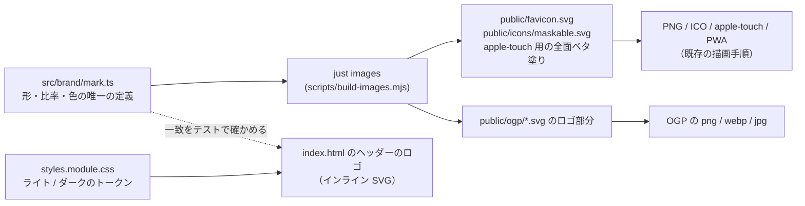

# CosPL のマーク・ロゴ刷新とダークモード 設計

## 意図

今のロゴ（「Cos」+ 角丸の枠で囲んだ「PL」）は安直で CosPL を連想させにくく、アイコン（2 つの輪）とも別の発想で作られていて 1 つのブランドに見えない。マークを 1 つに決め、アイコンとロゴの両方に使う。

マークが表すのは「カメラマンとコスプレイヤーの約束と、そこから始まる対話」。Cos の C がレンズになって、中の点（被写体＝コスプレイヤー）を包む。C は © も思わせ、許諾の文書であることも伝える。

あわせてサイトをダークモードに対応させる。マークの配色をライトとダークの 2 通りで決めたので、サイト側もそれに合わせて切り替える。

## ゴール

- マーク C を、ファビコン・PWA アイコン・apple-touch-icon・OGP 画像・サイトのロゴのすべてに使う
- マークの形・比率・色を 1 か所で定義し、全サイズで同じ比率に揃える
- サイトを OS の設定（`prefers-color-scheme`）に従ってライト / ダークで切り替える

## ゴールでないもの

- サイト上の手動のテーマ切り替えボタン（後から足せる。今回は OS に従うだけ）
- タグのアイコン（BY・NC など 7 個）のデザイン変更。ダークモードで色が追従することだけを確かめる
- X のプロフィールアイコンの差し替え作業（生成した PNG を Hidari が手で上げる）

## してはいけないこと

- マークの形や比率の数値を複数のファイルに手書きで散らすこと。比率を全サイズで固定したいという要望そのものが崩れる
- ダークモードで濃い地の部品（識別子バー、ツールチップ）まで白く反転させること
- 色だけで情報を伝えること（frontend-practices）。二人（C と点）は形でも区別できているので、1 色で刷っても成り立つ

## 決まったこと

### マークの形

- 図形は 2 つ。C の弧と、中の点
- 現行の座標系（viewBox 0 0 100 100）での定義:
  - 弧: 中心 (50, 50)、半径 30、線幅 11、丸い線端。(72, 30) から反時計回りに (72, 70) まで（大きい弧）
  - 点: 中心 (52, 50)、半径 11
- C の外形ぴったりの枠は縦 14.5〜85.5（71）。横は左が重いので、見た目の中心に寄せた 71 四方の枠 `10.5 14.5 71 71` を使う（ブラウザでの比較に使った値）

### 比率

| 対象 | 決まり |
|------|--------|
| アイコン（角丸の地つき） | マークの高さ = 一辺の 75%。全サイズ共通 |
| maskable アイコン | マークが中心の安全円（直径 = 一辺の 80%）に収まるまで縮める |
| ロゴ | マークの高さ = 文字の大きさの 1.05 倍、マークと文字の隙間 = 文字の大きさの 28% |
| apple-touch-icon | 角丸を付けず全面を地色で塗る（iOS は透明な角を黒く塗るため）。マークの高さは一辺の 75% |

### ロゴの組み方

- ロゴは「マーク」+「CosPL」の 5 文字。マークが C の代わりになるのではなく、マークの意味が「Cos の C がレンズになったもの」
- 文字は Space Grotesk の 700、字間 -0.02em、1 色（作る人の判断として、ブラウザで見せた見本の値を採用）
- マークは文字の 1em の箱の縦の中央に揃える（同上）。ヘッダーの HTML と OGP の SVG で同じ比率を使い、比率は `mark.ts` に置く

### 色

| 場面 | 地 | C | 点 | 文字 |
|------|----|---|----|------|
| アイコン・ライト | 紫 `#7b54ff` | 白 `#ffffff` | 淡いオレンジ `#ffb37a` | - |
| アイコン・ダーク | 紫紺 `#1c1430` | 薄紫 `#a98bff` | オレンジ `#ff9e5c` | - |
| ロゴ・ライト | 白（ページ） | 紫 `#7b54ff` | オレンジ `#ff7a2f` | 紫紺 `#1c1430` |
| ロゴ・ダーク | 紫紺（ページ） | 薄紫 `#a98bff` | オレンジ `#ff9e5c` | 白 `#ffffff` |

切り替えられない画像（PNG・ICO・OGP・apple-touch-icon・PWA アイコン）はライトの配色に固定する。`favicon.svg` は SVG 内の `@media (prefers-color-scheme: dark)` でダークの配色に切り替える（Chrome / Firefox。Safari は PNG / ICO を使う）。

### ダークモード

- OS の設定に従うだけ。CSS の `@media (prefers-color-scheme: dark)` でトークンを差し替え、JS は使わない
- `--ink` は文字色と濃い地の両方に使われている（識別子バー `.id`、ツールチップ 2 種）。役割ごとにトークンを分け、濃い地の部品はダークでも濃い地のまま（ページより一段明るい地）にする
- トークンの外に直書きされた色が `styles.module.css` に 18 か所ある（`#fff` 14、`rgba` 4）。すべてトークンへ置き換える
- `<meta name="theme-color">` を `media` 付きでライト / ダークの 2 本にする

## 作り方（選んだ案）

### 検討した案

軸 1: マークの定義の置き場

- A. 1 か所の定義から生成する（採用）: 形・比率・色を TS のモジュール 1 つに置き、`just images` がそこから SVG を書き出し、既存の手順で PNG・ICO・OGP まで作る。書き出したファイルはコミットし、生成結果と一致することをテストで確かめる（golden と同じ作法）
- B. SVG を手で書き、比率のずれをテストで見張る: 仕組みは増えないが、同じ数値が 6 か所に散らばる

A を選んだのは、「比率を全サイズで固定する」という要望が「同じ数値を 1 か所で持つ」ことそのものだから。

軸 2: ダークモードの切り替え

- D1. OS の設定に従うだけ（採用）: CSS だけで完結し、ファビコンと同じ仕組みでサイト全体の挙動が揃う
- D2. 切り替えボタンも付ける: 好みの保存、読み込み直後のちらつき対策、ボタンの E2E が増える

### 構成

- `src/brand/mark.ts`: 形・比率・色の定数と、SVG 文字列を返す純粋関数（マーク単体、角丸の地つきアイコン、ダーク切り替えつきファビコン、maskable、ロゴ）。外部依存なし
- 今どこからも参照されていない `public/icons/mark.svg` は削除する（作る人の判断）
- `scripts/build-images.mjs`: `regen-golden.mjs` と同じく esbuild で `mark.ts` を bundle して読み込み、上の SVG を書き出してから既存の描画へ進む
- OGP の SVG は書き出し元のデザインツールの構造（1 文字ずつの `text`）のままなので、ロゴ部分だけを目印のコメントで囲み、`just images` がその間を生成したロゴで置き換える
- サイトのロゴは `index.html` のインライン SVG と「CosPL」の文字。色は CSS のトークン（ライト / ダークで切り替わる）から取る。マークの座標が `mark.ts` と一致することはテストで確かめる
- 旧ロゴのスタイル（`.wordmark` / `.pl` / `.pl-t`）は削除する

## テスト

| 種類 | 確かめること |
|------|--------------|
| ユニット | 角丸の地つきアイコンでマークの高さが一辺の 75%、ロゴの隙間が 28%・マークの高さが 1.05 倍、maskable でマークの外形が安全円に収まる（外形の点と中心の距離で計算） |
| 一致（drift） | コミット済みの `favicon.svg` / `maskable.svg` / OGP のロゴ部分が `mark.ts` の出力と一致する。`index.html` のマークの座標が `mark.ts` と一致する |
| コントラスト | ライト / ダークの両方で、本文の文字と地の組み合わせが WCAG AA（4.5:1）、大きい文字と UI 部品が 3:1 を満たす。トークンは `styles.module.css` を `?raw` で読んで取り出す。マークの色（ロゴ・アイコン）は WCAG がロゴを除外していることと、二人を形でも区別していることから対象外とし、テストの対象の一覧にそう書く |
| CSS | `styles.module.css` のトークン定義の外に色の直書きが無い |
| E2E | `colorScheme: "dark"` でページの地と文字がダークのトークンになる。ヘッダーのロゴがアクセシブルな名前「CosPL」を持つ |

変異注入で、比率の定数・ダークのトークン・一致の検査をそれぞれ壊したときに対応するテストが赤くなることを確かめる。

## 作る人に任せること

- ダークモードの各トークンの具体的な値（上の色の表と、コントラストのテストを満たす範囲で決める）
- トークンの名前の付け方（役割が分かる名前にする）
- OGP の中でロゴを置く位置と大きさ（今のワードマークと同じ場所・同程度の大きさを目安に）
- maskable で縮める倍率（安全円に収まる最大の値）

## リリース

マージ後に `just release-site` でサイトを出す（条文は変わらないので `release-license` は要らない）。OGP 画像が変わるので、X のカードのキャッシュは `og:image` の `?v=` を上げて切り替える。
