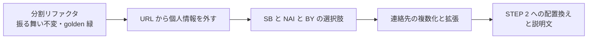

# README の拡張・データバック・NAI 明確化 設計

2026-10-26 時点のスナップショット。実装後の正は `src/` とテスト。

## 意図

撮影者が実際に納品データへ同梱している README には、CosPL の文面に無い項目がある（データバック、書き出しサイズ、加工の自由度、撮影者側の利用など）。CosPL を「本体（タグで決まる共通の条件）＋ユーザーが自由に足せる拡張」の 2 層にし、実運用の README をそのまま CosPL で作れるようにする。

あわせて、NAI の文面が生成 AI を使った加工まで禁止しているように読める点と、X 前提のクレジット文面を直す。個人情報は URL に残さない。

## ゴール

- 新タグ `SB`（データバック）を追加する
- NAI の禁止範囲を「学習」と「写真を元に別の作品を生成すること」に限定し、生成 AI を使った加工は許可だと明記する
- BY のクレジット依頼の方法を選択式にし、X 前提の表現をなくす
- 撮影者が見出しと項目を自由に書ける拡張を、ひな形つきで追加する
- 連絡先を複数入力できるようにする
- URL（hash）にはタグと選択肢だけを残し、撮影日・撮影者名・連絡先・拡張は残さない
- 入力欄を STEP 2 の中へ移す

## 非ゴール

- アイコンとロゴの刷新（別プロジェクト。`SB` のアイコンは暫定で既存の線画の作法に合わせて作り、刷新時に作り直す）
- 入力内容の保存（localStorage などへの永続化はしない）
- 拡張の内容の機械可読化（AI 宣言に拡張の本文は載せない）

## アンチゴール

- 拡張で本体の条件（NC・NAI など）が骨抜きにできてしまうこと
- 個人情報が URL・共有リンク・エンドポイントのクエリに残ること
- 一般の利用者に Markdown の記法を書かせること
- 生成 AI 機能を含む一般的な加工アプリの利用まで禁止に読めること

## 決まったこと

### 文書の構造

- 本体はタグで決まる章。識別子と AI 宣言に反映される
- 拡張は本体の章のあと、連絡先の前に置く
- 拡張が 1 つ以上あるとき、識別子の末尾に ` +` を付ける（例: `CosPL 1.0 / BY-NC-NAI-TD +`）。拡張は内容ではなく「本体以外の条件がある」ことだけを示す
- 拡張があるとき、拡張の章の冒頭に「以下は本文書への追加事項です。本文書の条件と矛盾する場合は本文書の条件が優先します。」の旨を入れる
- 矛盾の防止はこの優先順位の文言だけで行い、拡張の本文を機械的に検査しない
- AI 宣言には拡張の本文を載せず、拡張があるときだけ「人間向け README に追加事項があり、上の条件が優先する」旨の 1 行を足す（判断: 実装側）
- `format=text` の README にも拡張は出る（見出し記号を外す既存の処理に乗る）

### 版

- この変更で CosPL 1.1 を出す。識別子は `CosPL 1.1 / …` になる
- 版の運用は Creative Commons に準拠する
  - 条件の中身が変わるときだけ新しい版を出す。既存タグの意味の変更・タグの廃止や改名・識別子の書式の変更・許諾の構造の変更はメジャー、任意のタグや仕組みの追加とあいまいな文言の解消はマイナー
  - パッチ版は作らない。誤字や言い回しは版を変えずにその場で直す
  - 古い版は公開したまま有効。自動では新しい版に移らず、どの版を使うかは書いた本人が選ぶ。1.0 の文言を 1.1 の線引きで読み替える旨は書かない
- この運用を `v1.1/TAGS.md` に 1 節として書く
- `v1.0/` は変更せずに残し、`v1.1/` に本文・タグ仕様・README テンプレートを置く
- 版の文字列は定数 1 か所にまとめ、`src/client/main.ts` が別に組み立てている識別子の HTML もそこから作る
- AI 宣言の `terms_url` はその版の本文を指す。サイトと `public/llms.txt` の本文・タグ仕様へのリンクも v1.1 へ向ける
- `public/llms.txt` の README テンプレートへのリンクが実在しないファイル名を指しているので、あわせて直す
- OGP 画像の `CosPL 1.0 /` の描き直しは、アイコンとロゴの刷新で行う

### SB（データバック）

- タグの略号は `SB`（Send Back）。画面と README の表記は「データバック」
- 定義順は TD と MR の間（`BY, NC, NAI, TD, SB, MR`）。MR は禁止事項への例外という別種の取り決めなので最後に残す
- 識別子のタグは集合として意味を持ち、順序は表示の正規形にすぎない（`parseTags` は入力順に依らず受理し、出力は定義順に並べる。既存テストが固定済み）。この原則を `public/llms.txt` にも明記する。SB は新しいタグなので、この位置に入れても既存の識別子の表示は変わらない
- チップの説明に初見の人向けの補足を付ける（例: 掲載用に撮影者へ写真を返送すること）
- ON のとき README に「データバックについて」の章を入れる。固定文面は「SNS やポートフォリオなどに掲載するため、写真の返送をお願いします」の旨のみ
- 章の下に自由記述欄の内容を 1 行 1 項目で入れる。自由記述が空なら固定文面だけ
- AI 宣言に `photo_send_back_requested: yes   # SB` 相当の行を足す（OFF の値の表し方は既存タグの書式に合わせる）
- 既定のタグ選択（`DEFAULT_TAGS`）には含めない（MR と同じ任意タグ）
- 自由記述欄は STEP 2 の入力欄の並びに置き、SB が ON のときだけ表示する（判断: 実装側）。OFF にしても入力値はページ内に保持するが出力しない。URL には出さない

### NAI の線引き

- 許可: その写真を仕上げるための加工。AI を使うノイズ除去・アップスケール・レタッチ・映り込み除去に加え、背景の拡張や衣装の描き足しなど部分的な生成も含む
- 禁止: 学習データとしての利用と、写真を元に別の作品（画像・動画）を生成すること（img2img、顔や姿の使い回し、動画化など）
- 判断の軸: できあがったものが、その写真を加工したものと言えるか
- 人間向け README・AI 宣言（`Notice to AI systems` と条件行）・`public/llms.txt`・チップの説明文のすべてに同じ線を反映する。現行の `generative input` という表現は加工まで含むので使わない

### BY のクレジット依頼の方法

- BY の下位の選択肢として 2 つから選ぶ
  - SNS の機能による本文内でのメンションやタグ
  - 方法は問わない
- 既定は前者（現行の意図に近い）
- 識別子には反映しない（権利の意味は同じで、お願いの仕方だけが変わるため）
- BY が OFF のときは選択肢を隠し、値は URL に出さない
- README の BY の章に「クレジット表記のテンプレートをお持ちの場合はそちらでも構いません」を足す
- 「方法は問わない」のときは、メンションの行を「クレジットの方法は問いません」の旨に置き換える（判断: 実装側。リリース前の確認で文面を詰める）
- `/license.md` もクエリで同じ選択肢を受ける。不正値は `view` / `format` と同じく 400 にする。AI 宣言にも依頼の方法を 1 行で載せる（判断: 実装側）

### 拡張の入力

- 1 つの拡張は「見出し」と「本文」の 2 欄。本文の 1 行が 1 項目になり、README ではアプリが箇条書きにする。空行は捨てる
- 「＋ 項目を追加」で白紙の拡張を足す。各拡張は削除できる
- ひな形ボタン「データの内容物」「加工」「撮影者側の利用」。押すと、一般化した文面入りの拡張が足され、自由に書き換えられる。数値（書き出しサイズなど）は `[◯]` のようなプレースホルダで入れ、利用者が書き換える
- 見出しも項目も既存のフリーテキストと同じサニタイズ（制御・双方向文字と山括弧の除去、長さ上限）を通す。見出しが空の拡張は出力しない

### 連絡先

- 「＋ 連絡先を追加」で複数入力できる。README の連絡先の章に 1 行ずつ箇条書きで出す
- すべて空ならプレースホルダ `[連絡先をここに記入]` を 1 行出す（ダウンロード後の手書きを想定）。一部だけ空の行は捨てる
- 撮影者名と最終更新日の空欄時のプレースホルダは現行のまま

### URL と個人情報

- hash に残すのはタグ（`SB` を含む）と選択肢（クレジット依頼の方法）だけ
- 撮影日・撮影者名・連絡先・拡張は URL に入れない。ページを開き直すと消える
- 古い URL に `date` / `photographer` / `contact` が含まれていたら、読み込まずに捨て、URL からも取り除く（後方互換より個人情報を残さないことを優先）。取り除くのは読み込み時の 1 回の `history.replaceState` で行う
- hash の復元はタグと選択肢だけを返す型にし、入力欄の値は hash と無関係に持つ。この境界は分割リファクタの時点で切る
- `=` を含まない裸のタグ列の hash は引き続き受け付ける
- 「入力すると URL に載る」を固定している既存のユニットテストと E2E は、「載らない・古い値は捨てて消える」仕様へ書き換える
- 画面の説明文とヘルプを実態に合わせる（入力内容はページを閉じると消える、共有リンクはタグと選択肢だけ）

### 画面の配置

- 入力欄（撮影者名・最終更新日・連絡先・拡張）を STEP 2 の中、タブの上へ移す。AI 宣言のタブでも隠さない
- クレジット依頼の方法の選択は STEP 1 の BY のチップに付ける

## 作り方の候補

- 案 1: 現行の `core.ts` にそのまま足す。変更は最小だが、1 ファイルが 500 行を超え、責務がさらに混ざる
- 案 2: 先に `core.ts` を責務ごとに分割し、それから機能を足す（採用）
- 案 3: 文書を「章のデータの並び」として定義し、汎用の描画器で出す。本体の章どうしの条件の絡み（NC と MR の注記など）がデータに散らばり、今の規模では抽象化が先走る

案 2 を採用した理由: 今回の変更は「文書の生成」と「URL の hash」に集中している。先に分けておけばそれぞれが閉じた小さな変更になり、分割そのものは golden（出力のバイト一致を固定するフィクスチャ）が緑のままであることで安全に確かめられる。

## 進め方の段取り

- 分割は振る舞いを変えない PR として先に出す
- 以降は文面が変わるので、golden を `just regen-golden` で更新し、差分を目で確かめる

## 影響を受ける面

- `src/core.ts`（分割先を含む）: タグ、hash、サニタイズ、README と AI 宣言の生成
- `src/client/main.ts` と `index.html`: 入力欄、選択肢、配置、説明文
- `src/worker.ts`: `/license.md` エンドポイント。クエリで受けるのはタグと選択肢だけ。個人情報や拡張は受けない
- `src/discovery.ts`: OpenAPI の `tags` の説明と、選択肢のパラメータ
- `public/llms.txt`: タグ一覧に `SB` を追加、NAI の説明を新しい線引きへ、版とリンクを 1.1 へ
- `v1.1/`: 本文・タグ仕様（版の運用の節を含む）・README テンプレート
- `index.html`: 識別子の初期表示、本文とタグ仕様へのリンク
- `public/icons/`: `sb.svg`（暫定）
- テスト: `test/core.test.ts`（分割に合わせて分ける）、`test/worker.test.ts`、`test/__fixtures__/golden.json`、`e2e/url-hash.spec.ts`、`e2e/tags.spec.ts` ほか

## 実装者に任せること

- 分割後のモジュール名と境界の細部
- 選択肢の hash 上のキー名と値（短く、意味が読めるもの）
- ひな形の具体的な文面（実運用の README を一般化したもの。固有の値は入れない）
- 見出し・項目・連絡先 1 件あたりの長さ上限と、拡張・連絡先の個数の上限
- `SB` の暫定アイコン
