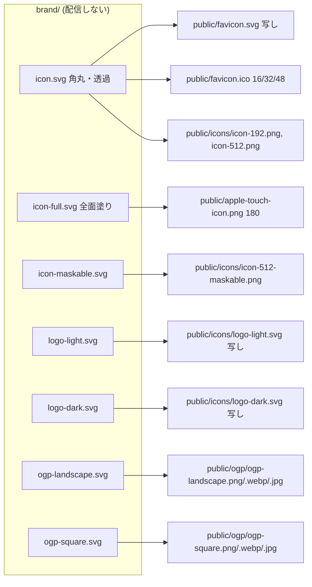

# ブランド画像を Affinity 書き出しの SVG マスターから作る

## 意図

アイコン（favicon・PWA・apple-touch）、ヘッダーのロゴ、OG 画像を、Hidari が Affinity で直接直せるようにする。今はマークの形・比率・色が `src/brand/mark.ts` のコードで決まっていて、見た目を少し変えるだけでもコードとテストを触る必要がある。デザインの調整はデザインツールで行い、リポジトリはその書き出しを受け取って配信用の形式へ変換するだけにする。

## ゴール

- Affinity から決まったフォルダへ SVG を書き出し、`just images` を叩けば、配信するブランド画像がすべて更新される
- 書き出しが古いまま（ラスタ画像の作り直し忘れ）や、配信してはいけない中身を含む SVG を、テストが捕まえる

## 非ゴール

- Affinity のオリジナル（`.af`）をリポジトリで管理すること。オリジナルはリポジトリの外に置く
- X のプロフィール画像など、サイトの外で使う画像の生成
- ダークモード用の favicon。favicon はライト版の 1 枚だけにする（紫の地なので暗いタブでも見える）

## 失敗とみなすもの

- 書き出した SVG を置いて `just images` を叩く以外の手作業（サイズごとの書き出し、HTML の手修正）が要る
- 配信される SVG が、スクリプト・イベント属性・外部参照を持てる状態になる（同一オリジンで配信されるので、SVG を直接開かれたときにスクリプトが動く）

## 決まったこと

- マスターは Affinity から文字をアウトライン化して書き出した SVG。`<text>` を含まない
- マスターはリポジトリ直下の配信されないフォルダ `brand/` に置く（案 A）
- ヘッダーのロゴは、マークと文字を含むロゴ全体をライト用とダーク用の 2 枚で描き、`<picture>` と `prefers-color-scheme` で切り替える
- `src/brand/mark.ts`・その一致テスト・OGP 用の和文フォント（`scripts/fonts/`）と描画時のフォント埋め込みは撤去する

## 検討した案

- A. `brand/` にマスターを置き、`just images` がラスタ化と `public/` への写しを行う（採用）。書き出し先が 1 つで、配信物と材料の境目がはっきりする。favicon.svg とロゴはマスターと写しの 2 か所にあるが、写しは生成物でテストが一致を見張る
- B. 書き出し先を `public/` の中にする。写しは要らないが、maskable や OGP の SVG のような材料まで配信され、書き出し先が散らばる
- C. スクリプトをやめて PNG なども全部 Affinity から書き出す。コードは最小だが、書き出しが 10 枚以上になってサイズの指定ミスが起きやすく、複数サイズの favicon.ico を作りにくい

## マスターと生成物

- ファイル名は上の 7 つに固定する。Hidari は同じ名前で上書き書き出しする
- アイコン 3 枚は正方形の viewBox。OGP は 1200x630 と 1200x1200 の比率。ロゴ 2 枚は同じ viewBox
- ロゴの写しを `/icons/` に置くのは、Service Worker が `/icons/` を swr のシェル資産として扱い、precache の一覧にも載せられるため（オフラインでもヘッダーのロゴが出る）
- `public/ogp/*.svg` は配信をやめる（材料は `brand/` へ移る）
- 最初のマスターは、アイコン 3 枚を現行の `mark.ts` の出力から作って置ける。ロゴ 2 枚と OGP 2 枚は文字のアウトライン化が要るので Hidari が Affinity から書き出す

## just images

- マスターを Chrome（playwright-core）で実寸描画して PNG にし、cwebp と magick で WebP・JPEG・ICO にする。現行の描画と変換の部分は残し、フォントの組み立てと `mark.ts` の読み込みを外す
- favicon.svg とロゴ 2 枚は `public/` へバイト単位で写す
- 各マスターの SHA-256 を `brand/generated.json` に書く。テストはマスターの今のハッシュとこれを比べ、マスターを変えたのに `just images` を叩き忘れた状態を捕まえる
- OGP のキャッシュ回避のクエリ（`og:image` と `twitter:image` の `?v=`）を、ogp-landscape のマスターのハッシュの先頭から作り、`index.html` を書き換える。X のカードキャッシュを手で外す作業を無くす

## ヘッダーのロゴ

- `<picture>` に `media="(prefers-color-scheme: dark)"` の `<source>`（logo-dark.svg）と、`` を置く
- `` の `width` / `height` 属性はロゴの viewBox に合わせ、CSS は高さを em で決めて `width: auto` にする（CLS の予約と、比率を変えたときの追従のため）。属性は `just images` が viewBox から書き換える（HTML の手修正を要らなくするため。構築者の判断として記録）
- `.logo` の文字用の CSS（フォント・字間）と、`--logo-c` / `--logo-dot` のトークンは使わなくなるので消す

## 配信する SVG の安全性

マスター 7 枚すべてについて、テストで次を確かめる。

- `<script>`・`on*` 属性・`<foreignObject>` を含まない
- `href` / `xlink:href` は文書内の `#id` か、埋め込みのラスタ画像（`data:image/png` / `jpeg` / `webp`）だけを指す。CSS の `url()` と `@import` も文書内の `#id` だけにする
- `<text>` を含まない（アウトライン化の確認。画像として読まれる SVG にはサイトのフォントが届かない）
- Affinity が書く XML 宣言・外部 DTD の DOCTYPE・名前空間の宣言（`xmlns:serif` など）は許し、写しはバイト単位のままにする。ただし DOCTYPE の内部サブセット（`[` と `<!ENTITY`）は拒否する。実体の展開で、生の文字列の検査をすり抜けた `<script>` が現れうるため（構築者の判断として記録）
- ルート要素が `<svg>` で、期待する比率の viewBox を持つ

## テスト

- 上の安全性と形の検査（vitest、`?raw` でマスターを読む）
- `public/` の写し 3 枚がマスターと一致する
- `brand/generated.json` のハッシュが今のマスターと一致する
- `index.html` の `?v=` が ogp-landscape のハッシュから作った値と一致する
- `index.html` のロゴの `` の `width` / `height` の比率がロゴの viewBox と一致する
- E2E: ヘッダーのロゴが名前「CosPL」の画像として見え、ライトとダークで表示される画像が切り替わる
- 既存の manifest・Service Worker・worker のテストは、パスが変わらないものはそのまま。precache の一覧にロゴ 2 枚を足す

## 撤去するもの

- `src/brand/mark.ts`、`test/brand/mark.test.ts`、`test/brand/generated.test.ts` の mark.ts 由来の検査、`test/brand/contrast.test.ts` の PALETTE との一致
- `scripts/fonts/`（和文フォントと OFL）と、`build-images.mjs` のフォント組み立て
- `public/ogp/*.svg`、`public/icons/maskable.svg`

## 守れなくなるもの

- maskable アイコンでマークが安全円（中心から半径 40%）に収まる保証。今は `mark.ts` の計算が持っている。手描きでは自動で守れないので、Affinity で描くときの注意として `brand/` に短い説明を置く

## 進め方（2 つの PR）

- PR 1: アイコン 3 枚と仕組み
  - `brand/` を作り、アイコン 3 枚のマスターを現行の `mark.ts` の出力から作って置く（ダーク用の `@media` は外す）
  - `just images` のアイコン部分をマスター起点に変え、安全性と形の検査・写しの一致・`generated.json` をアイコン 3 枚について入れる
  - `mark.ts` からアイコン専用の部分（アイコンの SVG 生成、maskable の安全円の計算）とその検査を外す。ロゴと OGP は今の仕組みのまま残す（OGP のロゴ差し込み、ヘッダーのインラインのマーク、和文フォント）
  - `public/icons/maskable.svg` の配信をやめる
- PR 2: ロゴと OGP の切り替え（Hidari の書き出しが揃ってから）
  - ロゴ 2 枚と OGP 2 枚のマスターを `brand/` に置き、ヘッダーを `<picture>` に、OGP をマスター起点に切り替える。`?v=` と `` の属性の書き換えもここで入れる
  - `mark.ts` の残り、`scripts/fonts/`、フォントの組み立て、`--logo-c` / `--logo-dot`、PALETTE との一致の検査、`public/ogp/*.svg` を撤去する
- PR 1 から PR 2 の間は、アイコンだけ新しい仕組みで、ロゴと OGP は旧い仕組みという状態が並ぶ

## 構築する人に任せること

- `brand/` に置く説明の書き方（書き出し設定、ファイル名、安全円の注意）
- PNG の寸法を確かめるテストを足すかどうか
- 外部参照の検査の正確な判定方法（属性の列挙か、パーサか）。依存は増やさない
